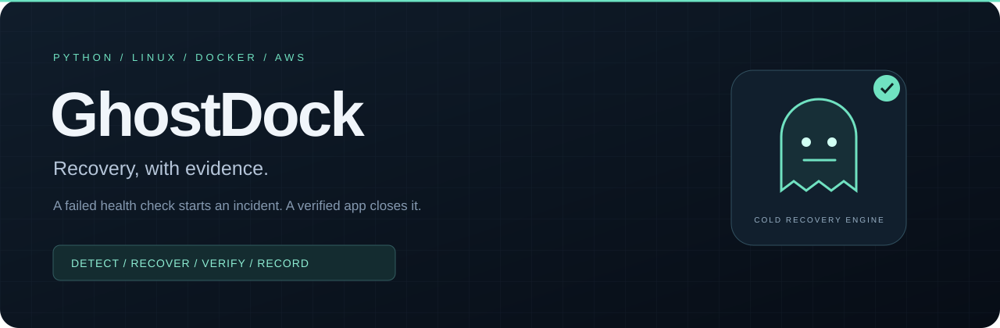
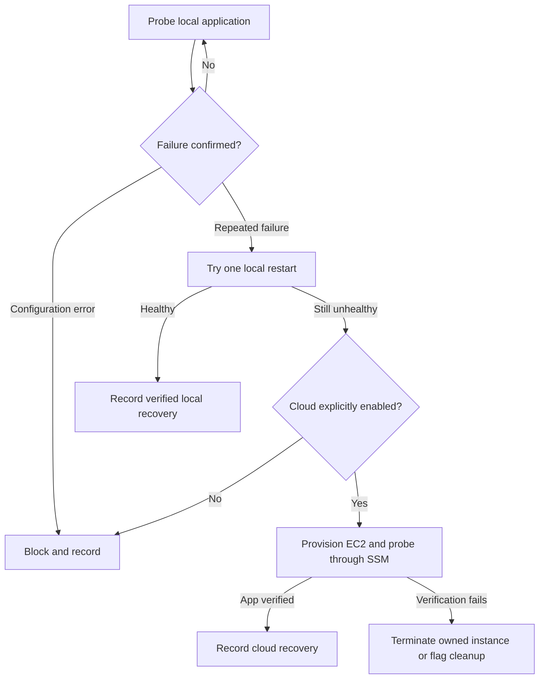

<p align="center"></p>

<p align="center">
  <a href="https://github.com/kadiwalarman1-rgb/GhostDock/actions/workflows/ci.yml"></a>
  
  
  <a href="LICENSE"></a>
</p>

# GhostDock

**Evidence-driven cold recovery for stateless Docker workloads.**

GhostDock watches a local HTTP service, confirms repeated health failures, attempts one bounded local restart, and can provision an EC2 replacement when recovery needs to move off the host. A cloud instance counts as recovered only after the application answers an identity-bearing health check through AWS Systems Manager.

Every incident produces a JSON event journal, a state snapshot, and a standalone HTML **recovery receipt**: what failed, what ran, what was verified, and what still needs cleanup.

**Status:** v0.1.0 engineering prototype. The no-cloud demo and isolated tests run without Docker or AWS credentials. CI includes a real Docker restart test. The EC2/SSM path is implemented and mock-tested; live AWS acceptance evidence is still pending. This release does not switch user traffic, restore application data, or guarantee zero downtime.

[Try the demo](#try-it-in-one-minute) · [Architecture](docs/architecture.md) · [AWS runbook](docs/aws-runbook.md) · [Hinglish walkthrough](docs/learning-guide-hinglish.md) · [Validation](docs/validation.md)

## Why this project exists

An exit code can say a command failed. It cannot prove an application recovered.

GhostDock started as my first Python + Bash + Docker project: capture `$?`, pass it into Python, and explore an OOP interface with `LocalNode` and `CloudNode`. The engineering question became: **what evidence should an automation system require before it says “recovered”?**

The answer in this repository is a small, inspectable recovery policy: confirm the failure, try the least expensive recovery, explicitly authorize cloud capacity, verify application health, and leave a receipt for the operator.

## Try it in one minute

Linux or WSL, Python 3.11+. No package installation, Docker daemon, AWS account, or API key is needed for this simulation.

```bash
git clone https://github.com/kadiwalarman1-rgb/GhostDock.git
cd GhostDock
python3 -m ghostdock demo
```

The command prints the generated incident directory. Open its `report.html` in a browser. The report prominently says **SIMULATION**: its clock and cloud resources are simulated, so its timings are not real recovery benchmarks.

```bash
python3 -m ghostdock demo --scenario local-recovered
python3 -m ghostdock demo --scenario blocked
python3 -m ghostdock demo --scenario rollback
python3 -m ghostdock demo --scenario cleanup-required
python3 -m ghostdock demo --scenario flapping
```

A [sample simulated receipt](docs/examples/simulated-recovery) is committed for inspection; download `report.html` and open it locally, or verify its JSON journal with `python3 -m ghostdock verify docs/examples/simulated-recovery`.

Failure scenarios deliberately return nonzero exit codes. See [the scenario matrix](docs/validation.md#scenario-matrix).

## Recovery policy



The controller handles one incident and exits after recovery. Keeping it available is the operator's responsibility. Whole-host failure requires an independent controller; this release runs on the monitored host.

## What makes the implementation worth inspecting

| Engineering decision | Concrete behavior |
|---|---|
| Evidence before success | HTTP 200 plus an expected application marker; EC2 allocation alone never means recovered. |
| Failure policy | Consecutive failures reduce reactions to transient glitches. Initial deployment/configuration errors do not launch AWS. |
| Local repair first | One bounded restart precedes optional cold recovery. |
| Explicit cost boundary | AWS is disabled by default. Real provisioning needs both `--live` and `--approve-cloud`. |
| Incident ownership | Local workload lock, persisted launch intent, EC2 client token, and workload/incident/config tags. |
| Recovery failure handling | Failed cloud health verification triggers scoped termination. Uncertain or denied cleanup remains visible. |
| Operational security | Digest-pinned public workload image in live mode, non-root container, read-only root, dropped capabilities, IMDSv2, encrypted root disk, and no inbound cloud ports. |
| Inspectable evidence | SHA-256-linked journal, atomic state snapshot, escaped HTML report, and an integrity-check command. |
| Reproducible review | Deterministic fault scenarios, unit/contract tests, Docker integration, static analysis, secret scanning, and image vulnerability checks. |

The receipt hash chain detects inconsistent edits; it is **not** a signature, tamper-proof storage, or independent proof that AWS executed a command.

## Run the real local Docker demonstration

Have Docker installed and usable by your current user. Run commands from the repository root.

```bash
docker build -t ghostdock-demo:local demo
python3 -m ghostdock watch --config config/local.toml
```

In another terminal, verify the application and deliberately stop **this demo container**:

```bash
curl --fail http://127.0.0.1:8080/healthz
docker kill ghostdock-demo
```

GhostDock should confirm the failure, restart its managed container, verify HTTP health, and finish with `RECOVERED_LOCAL`. Inspect the printed receipt path. This command does not enable AWS.

For a repeatable integration check with a uniquely named test container:

```bash
python3 scripts/docker_integration.py
```

## Real AWS recovery

Follow [the AWS runbook](docs/aws-runbook.md) to publish the public sample image by digest, create the lab network/profile, attach the scoped controller policy, and fill `config/aws.toml`.

```bash
python3 -m ghostdock plan --config config/aws.toml
python3 -m ghostdock check --config config/aws.toml --aws
python3 -m ghostdock watch --config config/aws.toml --live --approve-cloud
```

The cloud application binds to EC2 loopback. SSM verifies it without opening SSH or public application ingress. User-facing traffic routing is intentionally a separate future feature. See [the scope and trade-offs](docs/architecture.md).

After a live attempt, inspect and clean up the specific receipt:

```bash
python3 -m ghostdock verify /path/to/incident
python3 -m ghostdock cleanup /path/to/incident --config config/aws.toml
python3 -m ghostdock cleanup /path/to/incident --config config/aws.toml --execute
```

Successful recovery leaves the instance running for inspection. A boot-time expiry timer is a secondary safeguard; explicit cleanup and verification remain required. EC2, EBS, public IPv4, and data transfer can incur charges. “No standby instance” does not mean “zero AWS bill.”

## Repository map

| Path | Purpose |
|---|---|
| `ghostdock/engine.py` | Recovery policy and terminal outcomes |
| `ghostdock/local.py` | Docker ownership checks, deployment, probes, local restart |
| `ghostdock/cloud.py` | AWS CLI adapter, idempotent launch request, SSM verification, cleanup |
| `ghostdock/evidence.py` | Lock, durable incident state, linked event journal |
| `ghostdock/report.py` | Standalone recovery report |
| `ghostdock/demo.py` | Deterministic simulated failures using the real engine |
| `demo/` | Stateless non-root HTTP application and Dockerfile |
| `infra/` | Reviewable CloudFormation network and IAM foundation |
| `tests/` | Recovery, error propagation, ownership, cleanup, configuration, and integrity tests |
| `runner.sh`, `nodes.py` | Continuity with the original Bash/OOP learning milestones |
| `docs/` | Architecture, security, validation, AWS operations, and learning guide |

## Development

Runtime: Python standard library only. Development tooling is locked for Python 3.12.

```bash
python3 -m unittest discover -s tests -v
python3.12 -m venv .venv
source .venv/bin/activate
python -m pip install -r requirements-dev.lock
make lint security
python -m coverage run -m unittest discover -s tests
python -m coverage report
```

The CI badge links to actual runs. Do not treat a workflow file or a simulated receipt as evidence that the live AWS path has passed.

## Next milestones

- Record a live EC2/SSM acceptance run and cleanup evidence using the runbook.
- Add an external controller and a distributed incident lease for host-failure handling.
- Add explicit traffic cutover and fencing before calling this end-to-end failover.
- Design stateful recovery separately, with data consistency and measured recovery objectives.

Maintained by [@kadiwalarman1-rgb](https://github.com/kadiwalarman1-rgb). Started as a first DevOps/DevSecOps learning project and expanded with AI-assisted engineering. See [the learning journey](docs/learning-guide-hinglish.md) for the concepts and implementation decisions.

[MIT license](LICENSE) · [Security policy](SECURITY.md) · [Contributing](CONTRIBUTING.md)
